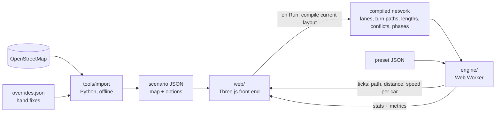

# FlowState — Product Requirements & Build Plan

**Team:** Dev (front end, import, compile, scoring) · Sashank (traffic engine)
**Demo:** December 1 / December 3, 2026
**Status:** v2. Replaces "FlowState-Dev-Plan.md". Starter files are in `flowstate-starter.zip` (see §16).

> **How to read this:** §1–5 are the "what and why". §7 is the data contract, which is the part both of us code against. §8–11 are each side's design. §12–14 are who does what and when. Anything marked **Assumption** is a call made to unblock work; change it if it's wrong, but tell the other person.

---

## 1. Overview

FlowState is a browser-based 3D traffic sandbox of **downtown Dallas**, built from real OpenStreetMap data. The player picks a time of day, watches traffic, pauses, changes individual road sections and intersections from a set of options, and runs again to see how the change ripples through the network.

**The story the demo tells:** intuitive fixes (adding a lane, adding a signal) often move or worsen congestion rather than fixing it. The "added lane trap" is the headline example: widening one section pushes more cars into a downstream choke point.

### Goals
- Real downtown street layout, cleaned up and converted into our own format.
- Three time-of-day presets with distinct traffic patterns.
- Every road section and intersection has a small menu of realistic alternatives.
- Visible ripple effects: queues, shockwaves, and a congestion heatmap.
- Data collected for efficiency and happiness scores, grounded in real traffic-engineering measures.

### Non-goals (for the demo)
- Pedestrians, cyclists, and buses as moving agents.
- Simulating freeway mainline traffic.
- A general "any city" map generator.
- Freehand road drawing.
- Mid-segment lane changing (see §8.3).

---

## 2. Scope

### 2.1 Area
- **Dallas Downtown Historic District core** (roughly Field/Akard to Harwood/Pearl, Commerce up to Pacific/Federal), **extended south to I-30**.
- Includes the **I-30 frontage road(s)** along the south edge and the **on- and off-ramps** between I-30 and the frontage road. Verify in the data exactly which frontage segments and ramps exist there.
- The exact boundary polygon is drawn by Dev in the import script. **Assumption:** it ends on clean intersections rather than mid-block where possible.
- We may expand to the rest of the freeway loop later. Nothing in the contract is specific to this area.

### 2.2 Highways
- Freeway mainlines are **static scenery** only, drawn at their real elevation (I-30 runs below street level through downtown).
- **Off-ramps are spawn points.** Cars appear at the top of the ramp stub and drive onto the frontage road.
- **On-ramps are sinks.** Cars disappear at the end of the ramp stub.
- Frontage roads are normal local roads in the simulation (signals, turns, everything).

### 2.3 Presets
Same map, same engine, different demand:

| Preset | Main flow | Character |
|---|---|---|
| **Morning** | Edges and off-ramps → **parking** | Heaviest load, arriving from the outside in. Cars despawn into garages. |
| **Afternoon** | Parking ↔ lunch zones | Light, short internal trips. |
| **Night** | **Parking → edges and on-ramps** | Morning reversed, leaving from the center outward. Garages start nearly full. |

All presets include a small share of through traffic (edge → edge) so the grid never looks empty.

---

## 3. Player experience

1. Load the app. Downtown Dallas appears with **Morning** selected and the sim paused.
2. Pick a preset (Morning / Afternoon / Night). The lighting changes with it.
3. Press **Run**. The sim starts **from empty**: cars flood in at **2× speed for the first ~5 seconds**, then settle to 1×.
4. Watch traffic, the congestion heatmap, and the score panel.
5. Press **Pause**. Traffic freezes and **editing unlocks**.
6. Click a road section or intersection. A panel shows its current layout plus its alternative options. Pick one; the 3D scene updates right away.
7. Make as many changes as you want, then press **Run**.
   - **If anything changed since the last run:** the sim **restarts from empty with the same seed**, so the before/after comparison is fair.
   - **If nothing changed:** Run resumes where it paused.
8. **Fast-forward** (4×) and **Skip ahead 5 min** buttons help get to the interesting part. **Reset** restarts the current layout from empty.
9. A **"Revert all"** button puts every element back on "Current layout".

**Assumption:** each element offers **"Current layout" plus up to 3 alternatives**. "Current" is always there so the player can revert one element, and it is the real-world baseline the scores compare against.

---

## 4. Tech stack

| Layer | Choice | Why |
|---|---|---|
| Language | **TypeScript** everywhere except the import script | Shared types for the contract on both sides. |
| Rendering | **Three.js (WebGL2)** with custom **GLSL** `ShaderMaterial`s for road markings and the heatmap | Used in class; the shaders are the OpenGL tie-in. |
| Cars | `InstancedMesh` | One draw call for all cars. |
| Build / dev server | **Vite** | Fast local dev, Web Workers built in. |
| UI overlay | Plain HTML/CSS over the canvas, `lil-gui` for debug sliders | A handful of panels doesn't need a framework. |
| Traffic engine | **TypeScript in a Web Worker**, no DOM or Three.js imports | Runs alongside rendering without freezing it; the same code runs headless in Node. |
| Engine ↔ UI | Worker `postMessage` with **transferable `Float32Array`s** | Cheap per-tick car data. |
| Tests / headless runs | **Vitest** + Node (`tsx`) | Run presets without graphics. |
| Import | **Python 3 + OSMnx** (+ `shapely`, `pyproj`) | Easiest way to pull and clean OSM road networks. Run once, offline. |
| Source control | One GitHub repo, a branch per person, PRs into `main` | |

Everything runs locally on Dev's laptop from one `npm run dev`. No separate server.

---

## 5. Architecture



Three files, three owners:

| File | Made by | Read by | Purpose |
|---|---|---|---|
| **Scenario** (`*.scenario.json`) | Dev's import script | Front end | The map: roads, intersections, options, spawn points, scenery. |
| **Compiled network** (`*.compiled.json` / in-memory) | Dev's compile step | Engine | The current layout as pure numbers: every lane and turn path with its length, plus conflicts and signal phases. |
| **Preset** (`morning.json` etc.) | Sashank | Engine (+ front end reads `lighting`) | Traffic demand for a time of day. |

**Key rule:** the front end owns all geometry. The engine never computes a coordinate. It moves cars by distance along paths and reports `(path, distance, speed)`; the front end turns that into x/y using its own curves. The compiled network is the only place the two meet, so both sides always agree on lengths.

---

## 6. Repo layout

```
flowstate/
├── shared/                 # Contract types + message protocol (Dev owns, both review)
│   ├── scenario.ts
│   ├── network.ts          # compiled network types
│   ├── preset.ts
│   └── messages.ts
├── engine/                 # Sashank — no DOM / Three.js imports
│   ├── src/
│   └── test/               # Vitest + headless harness
├── web/                    # Dev
│   └── src/
│       ├── compile/        # scenario + layout → compiled network (no Three.js)
│       ├── geometry/       # lane curves, intersection shapes (no Three.js)
│       ├── render/         # Three.js meshes, shaders, cars
│       ├── ui/             # panels, HUD
│       └── scoring/        # metrics → scores
├── tools/
│   ├── import/             # Python OSM → scenario JSON (+ overrides.json)
│   ├── compile-cli.ts      # Node: scenario → compiled JSON for headless tests
│   └── reference/          # make_sample.py (reference rules, see §16)
└── data/
    ├── scenarios/          # test-grid.scenario.json, downtown-dallas.scenario.json
    ├── compiled/           # *.compiled.json (generated, for engine tests)
    └── presets/            # morning.json, afternoon.json, night.json
```

`compile/` and `geometry/` must not import Three.js, so `tools/compile-cli.ts` can run them in Node and produce compiled files for Sashank's headless tests.

---

## 7. Data contract

### 7.1 Conventions (both sides)

| Topic | Rule |
|---|---|
| Units | Meters, seconds, m/s. Never mph or km/h in data. |
| Coordinates | Local meters from a fixed origin downtown (`meta.origin`). **x = east, y = north, z = up.** Three.js mapping: `(x, y, z)` → `(x, z, −y)`. |
| IDs | Stable strings. Nodes and edges keep their IDs across re-imports where possible (the import uses OSM IDs to derive them). |
| Edge | **One road section between two nodes, both directions.** Each edge is edited independently of its neighbors. |
| Reference direction | Each edge has `from` → `to`. `forward` lanes travel from→to; `backward` lanes travel to→from. A one-way street has an empty `backward`. |
| Lane order | **Left to right in the direction of travel, index 0 = leftmost.** For a two-way road, lane 0 of each direction is next to the centerline. |
| Lane widths | car / transit 3.5 m, bike 1.8 m (unless a lane has `width`). |
| Lane placement | Two-way: each direction's lanes sit on its own right-hand side of the centerline. One-way: lanes are centered on the centerline. |
| Guessed values | Any value the import filled in by default is flagged in an `estimated` object, e.g. `"estimated": {"speedLimit": true}`. |
| Raw OSM data | Every element carries `osmIds` / `osmWayIds` and an unprocessed `tags` object. Read freely; nothing depends on them. |
| Extra fields | Allowed anywhere. Unknown fields must be ignored, never cause an error. |
| Versioning | `format` + `version` at the top of each file. Bump `version` on a breaking change. |

### 7.2 Scenario file (`flowstate-scenario`, v1)

```jsonc
{
  "format": "flowstate-scenario",
  "version": 1,
  "meta": { "id", "name", "source": "osm" | "hand", "units", "origin": {"lat","lon"}, "bounds", "attribution" },
  "nodes":   [ Node ],
  "edges":   [ Edge ],
  "points":  [ Point ],
  "scenery": { "freeways": [...], "buildings": [...], "parks": [...] }
}
```

**Node**

| Field | Type | Notes |
|---|---|---|
| `id`, `name` | string | Name like "Main St & Akard St". |
| `x`, `y`, `z` | number | Position; `z` for ramp ends below grade. |
| `kind` | `intersection` · `merge` · `diverge` · `boundary` · `rampEnd` | `merge`/`diverge` = where a ramp joins/leaves a frontage road mid-block. `boundary` = a street crosses the map edge. `rampEnd` = the clipped end of a ramp stub. |
| `branch` | `{edge, side: "left"\|"right"}` or null | Merge/diverge only: which edge is the ramp and which side of the main road it's on. Texas ramps are usually on the **left** of the frontage road. |
| `restrictions` | `[{fromEdge, toEdge, type: "noTurn"}]` | Turn restrictions from OSM relations. May be empty. |
| `options` | `[NodeOption]` | First is always `current`. |
| `selected` | string | ID of the chosen option. |
| `locked` | boolean | True for non-intersections (nothing to edit). |
| `osmIds`, `tags` | | Raw. |

`NodeOption`: `{ id, label, control, params }`, where `control` is one of `signal`, `signalProtectedLeft`, `allStop`, `roundabout`, `yield`, `none`. `params`: roundabout `{radius}`; yield `{majorEdges: [edgeIds]}` (those approaches don't stop).

**Edge**

| Field | Type | Notes |
|---|---|---|
| `id`, `name` | string | |
| `from`, `to` | node ID | Reference direction. |
| `roadClass` | `primary` · `secondary` · `tertiary` · `residential` · `frontage` · `ramp` · `uturn` | |
| `centerline` | `[[x,y], …]` | From `from` to `to`, starting and ending exactly at the node positions. |
| `elevation` | `[z, …]` or null | One z per centerline point (ramps, bridges). Null = flat at 0. |
| `speedLimit` | m/s | |
| `estimated` | object | e.g. `{speedLimit: true, lanes: false}`. |
| `options` | `[EdgeOption]` | First is always `current`. |
| `selected`, `locked` | | Ramps are locked. |
| `osmWayIds`, `tags` | | Raw. |

`EdgeOption`: `{ id, label, kind, forward: [Lane], backward: [Lane] }`.
`Lane`: `{ type: "car" | "bike" | "transit", turns?: ["left"|"through"|"right"], width?: number }`. `turns` pins a lane to specific movements (e.g. a left-turn-only lane); omit it for normal lanes.

**Point** (spawns, sinks, parking, lunch zones)

| Field | Notes |
|---|---|
| `id`, `type`, `name` | `type`: `edgeSpawn`, `edgeSink`, `rampSpawn`, `rampSink`, `parking`, `lunchZone`. |
| `node` **or** `at: {edge, t}` | Spawns and sinks sit on a boundary or rampEnd node. Parking and lunch zones sit **on an edge** at fraction `t` (0–1) along the centerline from `from`. |
| `weight` | Relative pull (default 1). Off-ramps default to 3. |
| `capacity` | Parking only, in cars. |
| `estimated`, `osmIds`, `tags` | |

A two-way boundary street produces both an `edgeSpawn` and an `edgeSink` on the same node.

**Scenery** (front end only; engine ignores)
- `freeways`: `{id, name, centerline, width, z}`
- `buildings`: `{id, footprint: [[x,y]…], height, levels, use, estimated, name?}`
- `parks`: `{id, name, polygon}`

### 7.3 Option catalog

Each element gets **"Current layout" + up to 3 alternatives**, chosen by rules so they're realistic, with a deterministic rotation (hash of the element ID) so neighboring sections tend to get different menus. The import script generates them; Dev can hand-edit any of them in `overrides.json`.

**Road section (edge) alternatives**

| `kind` | Label | Effect | Eligible when |
|---|---|---|---|
| `widen` | Add a lane | +1 car lane in each direction that has lanes | Max lanes per direction < 4 |
| `roadDiet` | Remove a lane | −1 car lane per direction | Two-way with ≥2 lanes each way, or one-way with ≥3 |
| `bikeLane` | Protected bike lane | Rightmost car lane becomes bike (if ≥2 lanes); otherwise a bike lane is added | Always (except ramps) |
| `transitLane` | Bus/transit lane | Rightmost car lane becomes transit | A direction has ≥2 car lanes |
| `twoWay` | Convert to two-way | One-way n lanes → ⌈n/2⌉ + ⌊n/2⌋ | One-way, ≥2 lanes, not a frontage road |
| `oneWay` | Convert to one-way | All lanes go forward | Two-way, not a frontage road |
| `leftTurnLane` | Add left-turn lane | Adds a left-only lane (`turns: ["left"]`) at index 0 | The direction ends at an intersection |
| `carFree` | Car-free street | No car lanes | Tertiary/residential, neither end on the map boundary |

**Intersection (node) alternatives**

| `control` | Label | Eligible when |
|---|---|---|
| `signal` | Traffic signal | Always |
| `signalProtectedLeft` | Signal with protected left turns | Always |
| `allStop` | All-way stop | Every approach has ≤2 lanes per direction |
| `roundabout` | Roundabout | ≤4 approaches, ≤2 lanes per direction, no frontage road (keeps diamond interchanges out) |
| `yield` | Stop signs on side street | The approaches have different road classes |

Merge, diverge, boundary and rampEnd nodes are locked. Ramp edges are locked.

**Notes**
- `carFree` and option changes can make a spawn, sink, parking or lunch point unreachable. The compile step drops points with no remaining access, and the engine must handle a destination becoming unavailable (see §8.5).
- `oneWay` always keeps the edge's reference direction. If that creates silly dead ends in the real data, Dev can drop it for that edge in overrides.

### 7.4 Compiled network (`flowstate-network`, v2)

> **v2** added the required `ConnectorPath.stop` flag. v1 files cannot express
> which approaches of a `yield` node carry a stop sign, so readers reject them
> rather than defaulting the field.

Built by the front end from the scenario + the currently selected options, every time Run starts a new layout. Also exported to `data/compiled/` by `tools/compile-cli.ts` for headless tests.

```jsonc
{
  "format": "flowstate-network",
  "version": 2,
  "scenario": "test-grid",
  "layout": { "edges": { "eB1": "current", … }, "nodes": { "n11": "current", … } },
  "units": { "length": "m", "speed": "m/s", "time": "s" },
  "paths":  [ LanePath | ConnectorPath ],
  "nodes":  [ CompiledNode ],
  "points": [ CompiledPoint ]
}
```

**Paths.** Everything a car can drive on is a path. A path's position in the `paths` array is its **`index`**, which is what the engine sends in ticks.

`LanePath` (car lanes only; bike and transit lanes are not in the compiled network):

| Field | Notes |
|---|---|
| `id` | `L/{edge}/{f\|b}/{laneIndex}`, e.g. `L/eB1/f/0`. |
| `kind` | `"lane"` |
| `edge`, `dir`, `laneIndex` | Which lane of which edge. `laneIndex` counts every lane in that direction (including bike/transit), matching the scenario. |
| `fromNode`, `toNode` | |
| `length` | Meters from the start stop line to the end stop line. |
| `speedLimit` | m/s |
| `turns` | The lane's pinned movements, or null. |
| `next` | Connector IDs leaving the end of this lane. Empty at boundary/rampEnd. |
| `index` | Its position in `paths`. |
| `debugPolyline` | Optional `[[x,y]…]` for debugging. **The engine must not use it for simulation.** |

`ConnectorPath` (a turn path through a node, or a ring section of a roundabout):

| Field | Notes |
|---|---|
| `id` | `C/{node}/{fromLane}>{toLane}` |
| `kind` | `"connector"` |
| `node`, `from`, `to` | From lane → to lane. `next` = `[to]`. |
| `turn` | `through` · `left` · `right` |
| `length`, `speedLimit` | Turns use 6.7 m/s (15 mph); through uses the lower of the two lanes' limits. |
| `phase` | Signal phase ID, or null. |
| `stop` | **v2.** True when a car must come to a full stop at the end of the incoming lane: every connector at an `allStop` node, and connectors from the minor approaches of a `yield` node (incoming edge not in `majorEdges`). False at signals, merges, roundabouts and `none`. Compiled in because `majorEdges` never reaches the engine. Says only *whether* to stop — who to give way to is `yieldTo`/`conflicts`, and the gap length comes from `control` (§8.4). |
| `conflicts` | `[{path, type: "cross" \| "merge"}]`: connectors at the same node that cross this one or end in the same lane. Connectors from the same lane are never listed (cars on them are already in line). |
| `yieldTo` | Connector IDs this one must give way to (see §8.4). |

`CompiledNode`: `{ id, control, phases, inPaths, connectors }`. `control` is the selected control, or `merge` / `none` for merge and diverge nodes. `phases` (signals only): `[{id, paths: [connector IDs]}]`.

`CompiledPoint`: `{ id, type, weight, capacity?, access: [{path, s}] }`. `s` is the distance along that lane path. Spawns at a node use every lane leaving it (s = 0); sinks use every lane arriving (s = length); parking and lunch zones use the **rightmost car lane of each direction** of their edge.

**Compile rules** (the reference implementation is `tools/reference/make_sample.py`):

1. **Lane curves:** Offset the centerline per §7.1. Trim each end by the node's **setback**: intersection 12 m, merge/diverge 8 m, boundary/rampEnd 0, roundabout `radius + 6` m.
2. **Movements:** For each incoming approach and each outgoing approach at a node, classify the movement by the heading change: within ±35° = through, beyond ±150° = U-turn (dropped), otherwise left (counterclockwise) or right. Skip restricted pairs and the same edge.
3. **Which lane makes which movement:** Lanes with `turns` keep them. Other lanes split only the movements that actually exist: every lane may go through; the leftmost also takes the leftmost movement and the rightmost takes the rightmost. A single lane takes all of them. (At a T-intersection with only a right turn, every lane turns right.)
4. **Which lane it enters:**
   - If exactly **one lane** makes a movement, it gets a connector into **every** outgoing lane. This is where cars pick their lane for the next turn.
   - If **several lanes** make it, they map one-to-one from the turning side (left turns and through from the left, right turns from the right). Extra outgoing lanes are fed by the outermost source lane.
5. **Merge/diverge nodes:** Main-road lanes map straight through one-to-one. **Ramp lanes merging in may enter any main lane.** A diverging ramp is fed from the main road's lane on the ramp's side.
6. **Connector shape:** A quadratic Bézier from the end of the incoming lane to the start of the outgoing lane, with its control point where the two lane directions intersect (a straight line if they're parallel). It must start and end **exactly** on the lane endpoints.
7. **Conflicts:** Two connectors at the same node conflict if they end in the same lane (`merge`) or their curves intersect (`cross`), unless they start from the same lane.
8. **Signal phases** (`signal`): two phases, `NS` and `EW`, by the incoming lane's heading. `signalProtectedLeft`: four phases (`NS-left`, `NS`, `EW-left`, `EW`), with lefts only in their left phase.
9. **Yields and stops:** see §8.4. Set `stop` per the `ConnectorPath` table above. At a `yield` node, each minor-approach connector's `yieldTo` lists the conflicting connectors from the major approaches (the ones that don't stop).
10. **Roundabouts:** replace the node with a ring of short one-lane ring connectors (counterclockwise), plus entry connectors (each approach → ring) and exit connectors (ring → each departure). Entries list the ring sections they join as `yieldTo`. Cars on the ring follow each other like on any lane.

### 7.5 Preset file (`flowstate-preset`, v1)

```json
{
  "format": "flowstate-preset", "version": 1,
  "id": "morning", "label": "Morning",
  "durationSec": 1800, "seed": 20261201, "lighting": "morning",
  "warmup": { "realSeconds": 5, "playbackSpeed": 2 },
  "spawnRate": { "unit": "vehiclesPerMinute", "curve": [[0, 15], [300, 45], [900, 60], [1500, 30], [1800, 15]] },
  "trips": [
    { "share": 0.8, "from": ["rampSpawn", "edgeSpawn"], "to": ["parking"] },
    { "share": 0.2, "from": ["rampSpawn", "edgeSpawn"], "to": ["rampSink", "edgeSink"] }
  ],
  "parking": { "initialOccupancy": 0.1 }
}
```

- `spawnRate.curve`: `[simSecond, vehiclesPerMinute]` pairs, linearly interpolated. Total for the whole map.
- `trips`: each new car picks a trip type by `share`, then an origin and destination of those point types, weighted by `weight` (parking by free capacity).
- `parking.initialOccupancy`: fraction of every garage full at t = 0.
- `lighting`: front end only.
- The numbers in the starter files are for the test grid. **Sashank tunes them for downtown.**

### 7.6 Runtime messages (`shared/messages.ts`)

**UI → Engine**

| Message | Payload | Notes |
|---|---|---|
| `load` | `{network, preset, seed}` | Builds the engine's state from scratch, empty of cars. Sent on Run when the layout or preset changed. |
| `run` | — | Start or resume stepping. |
| `pause` | — | Stop stepping; keep state. |
| `setSpeed` | `{multiplier}` | Playback speed (1, 2, 4). |
| `skip` | `{simSeconds}` | Simulate ahead as fast as possible without sending ticks, then send one tick. |
| `reset` | — | Re-`load` the last network/preset/seed. |

**Engine → UI**

| Message | Payload | Rate |
|---|---|---|
| `ready` | `{pathCount}` | After `load`. |
| `tick` | `{simTime, count, buf: Float32Array}` | Every sim step (dt = 0.1 s), transferable. |
| `stats` | `{simTime, buf: Float32Array}` | Every 1 sim-second. Per path (by `index`), 4 floats: `[meanSpeed / speedLimit, occupancy 0–1, queueLength m, flow vehicles/min]`. |
| `metrics` | `{simTime, …}` (see §9.1) | Every 5 sim-seconds. |
| `error` | `{message}` | |

**Tick buffer layout:** 5 floats per car, `count` cars:

| Offset | Value |
|---|---|
| 0 | `vehicleId` (stable for the car's lifetime; unique within a run) |
| 1 | `pathIndex` (index into `paths`) |
| 2 | `s` — meters along that path |
| 3 | `speed` — m/s |
| 4 | `flags` — bit 0 braking, bit 1 stopped, bit 2 yielding |

The front end converts `(pathIndex, s)` to x/y and heading using its own curves, then **interpolates between the last two ticks in x/y** (not in `s`, because a car may switch paths between ticks).

---

## 8. Engine design (Sashank)

All of these are starting points; tune as needed.

### 8.1 Time and determinism
- Fixed timestep **dt = 0.1 s**. Playback speed changes how many steps run per real second, never dt.
- A single seeded PRNG (e.g. mulberry32) from `seed`. Process cars in a fixed order (by ID). **Same network + preset + seed ⇒ identical run.** This is what makes before/after fair.

### 8.2 Car following
- **Intelligent Driver Model (IDM).** Starting parameters: desired speed = path speed limit, time headway T = 1.5 s, max acceleration a = 1.0 m/s², comfortable braking b = 2.0 m/s², minimum gap s₀ = 2 m, exponent δ = 4, car length 4.5 m.
- A car's leader may be on its current path or further down its route (next connector, next lane). Look ahead along the route until a car or a stop line is found.
- Stop lines (red light, stop sign, yield) are treated as a stationary leader at the end of the lane.

### 8.3 Lanes and routing
- **No mid-segment lane changes.** A car's lane is decided by the connector it takes into each lane (§7.4 rule 4).
- **Route over the path graph directly** (lanes + connectors) with A*. Cost = length / expected speed, where expected speed is a smoothed recent mean on that path (speed limit when empty). This automatically picks lanes that lead to the right turns.
- Routes are computed at spawn. **Assumption:** a car re-routes when it enters a new lane if the remaining cost of a different route is >15% better, using costs refreshed every 30 sim-seconds. This is what makes traffic shift onto side streets after an edit.
- At spawn, pick an access lane from which the destination is reachable (some lanes can only go straight).

### 8.4 Intersections
| Control | Behavior |
|---|---|
| `signal` | Fixed-time: **60 s cycle**, green split proportional to the number of incoming car lanes per phase, 3 s yellow, 1 s all-red. A car may enter a connector only on its phase's green. Within a phase, connectors in `yieldTo` have priority (permissive lefts yield to oncoming through/right). |
| `signalProtectedLeft` | Same, with the four phases from the compile step and no permissive yields. |
| `allStop` | Every car stops at the stop line, then goes first-come-first-served, waiting while any conflicting connector is occupied. |
| `yield` | Cars from `majorEdges` don't stop. Minor approaches stop, then wait for a gap: **critical gap 4 s** to every conflicting major car. |
| `roundabout` | Entry connectors yield to ring traffic (`yieldTo`); ring traffic never stops. Same 4 s gap rule. |
| `merge` | Ramp connectors yield to the main-road connectors they conflict with, using a gap of 3 s. |
| `none` | Free flow (diverge points). |

General rule: a car only enters a connector if it won't block it, i.e. the outgoing lane has room for it (don't block the box). This prevents most gridlock.

### 8.5 Spawning, parking and despawning
- New cars are created by the preset's spawn curve. A car is inserted at its access point only if there's a safe gap; otherwise it waits in a **virtual entry queue**. Time spent in that queue **counts as delay** in the metrics (otherwise a jammed map would look good because nobody gets in).
- Parking: a car heading to parking **reserves a space** at spawn. If every garage is full, it's sent to a sink instead and counted as `parkingFailed`.
- Cars despawn when they reach their destination's `s` on the access lane (parking, lunch zone) or the end of a sink lane.
- If a destination becomes unreachable (e.g. car-free street), pick another point of the same type.
- **Gridlock safety:** a car stopped for more than **120 sim-seconds** is removed and counted as `gridlockRemovals`.

### 8.6 What the engine ignores
Bike and transit lanes (they reduce car capacity just by not being in the compiled network), scenery, `debugPolyline`, OSM tags.

---

## 9. Metrics and scoring

### 9.1 What the engine tracks (Sashank)
Sent in `metrics` every 5 sim-seconds, covering the period since the last message plus running totals:
- **Completed trips:** for each, trip time, free-flow trip time (route length / speed limits), time stopped, time in entry queue, origin and destination point.
- **Per node:** average control delay (actual time through the approach and node minus free-flow time) and number of cars served.
- **Per path:** max queue length.
- **Counts:** cars active, cars waiting to enter, `parkingFailed`, `gridlockRemovals`.

### 9.2 Scores (Dev, later)
Computed by `web/src/scoring` from `metrics` plus the layout (for bike/transit counts). Formulas come later; the plan is to ground them in real measures:

**Intersection level of service** (Highway Capacity Manual, average control delay per vehicle):

| LOS | Signalized (s/veh) | Stop-controlled (s/veh) |
|---|---|---|
| A | ≤ 10 | ≤ 10 |
| B | > 10–20 | > 10–15 |
| C | > 20–35 | > 15–25 |
| D | > 35–55 | > 25–35 |
| E | > 55–80 | > 35–50 |
| F | > 80 | > 50 |

**Trip level:** Travel Time Index = actual trip time ÷ free-flow trip time (the measure Texas A&M's Urban Mobility Report uses). For context, that report put the average US commuter at 54 hours of delay in 2023.

Likely shape:
- **Efficiency:** completed trips per minute vs. demand, mean Travel Time Index, share of intersections at LOS D or better.
- **Happiness:** mean Travel Time Index, stopped/idle time per trip, gridlock and parking failures as penalties, bonus for bike/transit lanes present.

**Calibration target:** with every element on "Current", the morning preset's busiest intersections should land around **LOS C–D**. Sashank tunes spawn rates toward that.

---

## 10. Front end design (Dev)

- **Geometry module (no Three.js):** lane curves per §7.4 rule 1, connector curves per rule 6, intersection footprints, roundabout rings. Used by both rendering and compile.
- **Road meshes:** one ribbon per lane (so lanes can be colored individually by the heatmap), plus intersection fill polygons and ramp stubs at their elevation. Rebuild only the edited element and its two end nodes when an option changes.
- **Markings shader:** lane lines, edge lines, bike lane green, transit lane red, stop bars, from lane type and position.
- **Cars:** one `InstancedMesh`, slot per `vehicleId`. Position from `(pathIndex, s)` → x/y via a per-path arc-length lookup table; heading from the curve tangent. Brake lights from flags. Headlights at night.
- **Heatmap:** per-lane color from `stats` (`meanSpeed / speedLimit`): ≥ 0.7 green, 0.4–0.7 yellow, < 0.4 red, blended.
- **Camera and selection:** orbit/pan/zoom; raycast against edge and node pick meshes; highlight the selection.
- **Options panel:** shows `options` for the selected element, disabled while running, applies the choice locally and marks the layout dirty.
- **HUD:** preset picker, Run/Pause, speed (1×/4×), Skip 5 min, Reset, Revert all, score panel, sim clock, "© OpenStreetMap contributors".
- **Lighting:** morning (low warm sun from the east), afternoon (high neutral), night (dark sky, street-light glow, headlights).
- **Run logic:** if `layoutHash` or preset changed → compile → `load` → `run` → apply warm-up speed; else `run`.

---

## 11. Import pipeline (Dev)

1. **Area:** a polygon covering the Historic District core extended south to I-30, including the north I-30 frontage road and its ramps.
2. **Pull** with OSMnx using a custom filter: drivable `highway=*` including `motorway_link`, frontage roads and U-turn links, but **excluding `motorway`** (mainlines go to scenery). Also pull buildings, `amenity=parking`, parks.
3. **Project** to local meters around a fixed origin with `pyproj`.
4. **Simplify** chains of nodes into edges between real junctions. **Consolidate** only tiny junction clusters (≈ 10 m) and **never merge the two signals of a diamond interchange**.
5. **Clip** at the polygon. Each street crossing the edge gets a `boundary` node; each ramp is cut where it meets the freeway and gets a `rampEnd` node.
6. **Classify:** `roadClass` from `highway=*`; frontage roads from `frontage_road=yes` or name patterns; ramps from `motorway_link`. Ramp junctions with the frontage road become `merge`/`diverge` nodes with `branch.side` computed from which side the ramp is on.
7. **Lanes:** from `lanes`, `lanes:forward/backward`, `oneway`; defaults by class when missing (flag `estimated.lanes`). Existing bike lanes from `cycleway*`.
8. **Controls:** `signal` where OSM has `highway=traffic_signals` at or within a few meters of the node; `allStop` where `stop` + `stop=all`; otherwise `yield` (minor approaches) or `none`.
9. **Restrictions:** OSM `type=restriction` relations → node `restrictions`. Best effort; remap through any merged nodes or drop.
10. **Points:** spawns/sinks from boundary and rampEnd nodes; parking from `amenity=parking` (garage entrance if tagged, else nearest edge, `t` by projection), capacity from `capacity` tag or **footprint area × levels ÷ 30 m²** (flag `estimated`); lunch zones hand-picked in `overrides.json`.
11. **Options:** generate per §7.3.
12. **Overrides:** `tools/import/overrides.json` holds every hand fix (lane counts, controls, deleted edges, extra restrictions, lunch zones, option tweaks). The script applies it last, so **re-running the import never loses hand cleanup.** Don't hand-edit the output JSON.
13. **Validate** before writing: every non-boundary lane can exit, every spawn can reach a sink (same checks as the reference script).

**Edge cases to expect:** dual carriageways split into two one-ways (fine, keep them), long frontage segments with mid-block ramp merges, bridges over I-30 (use `bridge`/`layer` for elevation; they don't connect to the freeway), missing lane counts on small streets.

---

## 12. Work split

### Dev — front end, import, compile, scoring

| # | Task | Done when |
|---|---|---|
| D1 | **Contract types** in `shared/` from §7 and this PRD's starter files. | Sashank has reviewed and both sign off. |
| D2 | **Geometry module** (lane curves, connector curves, intersection footprints, roundabout rings). | Reproduces the starter `test-grid.compiled.json` lengths within a few cm. |
| D3 | **Compile step** + `tools/compile-cli.ts`. | `npm run compile -- data/scenarios/test-grid.scenario.json` writes a compiled file matching the starter one; validation checks pass. |
| D4 | **Import script** + `overrides.json` for downtown. | `downtown-dallas.scenario.json` loads, passes validation, and looks right when drawn. |
| D5 | **Road and scenery rendering** (ribbons, intersections, markings shader, ramps at elevation, freeways, buildings, parks). | Downtown is recognizable; option changes rebuild instantly. |
| D6 | **Worker bootstrap + stub engine** that moves fake cars along random paths using the real message protocol. | Front end runs end-to-end without Sashank's engine. |
| D7 | **Car rendering** from ticks with interpolation, brake lights, headlights. | Smooth motion across path boundaries at 60 FPS with ~1,000 cars. |
| D8 | **Selection + options panel + Run/Pause/edit logic.** | Every option type applies, and Run restarts from empty with the same seed. |
| D9 | **HUD, heatmap, fast-forward, skip, reset, revert.** | All controls work. |
| D10 | **Preset lighting.** | Three distinct looks. |
| D11 | **Scoring** from `metrics`. | Scores update live and react to the added-lane trap. |

### Sashank — traffic engine

| # | Task | Done when |
|---|---|---|
| S1 | **IDM car following** on a single hard-coded lane. Can start **now**. | Headless run shows stop-and-go waves behind a slow car. |
| S2 | **Network loader** for the compiled format, with per-path leader lookup along routes. | Loads `test-grid.compiled.json`; reports path count. |
| S3 | **Spawning, entry queues, parking reservations, despawning** from presets. | Cars appear and leave at the right points; occupancy tracked. |
| S4 | **Routing** (A* over paths, cost refresh, re-route rule). | Cars reach destinations; closing a road shifts traffic. |
| S5 | **Intersection control:** signal, protected-left signal, all-way stop, yield, merge. | No overlaps or deadlocks on the test grid with every control type. |
| S6 | **Roundabouts** (entry yield, ring following). | Works on the test grid after switching a node to roundabout. |
| S7 | **Worker wrapper** with the §7.6 protocol, speed, skip, reset. | Front end receives ticks without frame drops. |
| S8 | **Stats and metrics** per §9.1. | Heatmap and metrics messages populate. |
| S9 | **Headless harness**: `npm run sim -- --network <file> --preset morning --minutes 30`. | Prints throughput, mean delay, LOS per node. |
| S10 | **Preset tuning** for downtown. | Morning current layout ≈ LOS C–D at the busiest nodes; the three presets look different; the added-lane trap is reproducible. |

---

## 13. Schedule

| Date | Dev | Sashank | Checkpoint |
|---|---|---|---|
| **Mon 11/23** | D1 | S1 | Starter files shared |
| **Tue 11/24** | D1 sign-off, D2, D3 | S1, S2 | **Contract signed off** |
| **Wed 11/25** | D4, D6 | S3, S4 | Engine runs headless on the test grid |
| **Thu 11/26** (Thanksgiving) | D5 | S5, S7 | |
| **Fri 11/27** | D7, D8 | S5, S8, S9 | **First integration** on the test grid |
| **Sat 11/28** | D9, real downtown data in | S6, S10 | Downtown running, morning preset |
| **Sun 11/29** | D10, D11 | S10 | All presets + options |
| **Mon 11/30** | Polish, rehearsal | Tuning, rehearsal | Added-lane trap demo locked in |
| **Tue 12/1 · Thu 12/3** | Demo | Demo | |

---

## 14. Priorities if time gets tight

**Must have:** downtown map; cars moving through signals; morning preset; lane-count options (`widen`, `roadDiet`); Run/Pause/edit with restart; heatmap.
**Should have:** afternoon and night presets; roundabout, all-way stop and protected-left options; bike/transit lanes; lighting; scores.
**Nice to have:** `twoWay`/`oneWay`/`carFree`; re-routing; skip-ahead; buildings and parks.

---

## 15. Open items

- Exact boundary polygon (Dev, while building the import).
- Which section of downtown we use for the added-lane trap demo (find it with the headless harness once downtown runs).
- Vehicle cap. Start at ~1,000 and adjust after the first performance test.
- Score formulas (Dev, after integration).
- Whether to allow a one-lane shift on through connectors if routes look unnatural (a cheap partial substitute for lane changing).

---

## 16. Starter files

`flowstate-starter.zip`:

| File | What it is |
|---|---|
| `data/scenarios/test-grid.scenario.json` | **The file to code against.** A hand-made 3 × 3 grid in the exact scenario format: a two-way 1+1 street, a one-way 2-lane street, a two-way 2+2 avenue, a one-way frontage road with an off-ramp merge and on-ramp diverge, 9 boundary nodes, 3 parking points (2 garages, 1 surface lot), 3 lunch zones, one turn restriction, an all-way stop, scenery, and generated options on every element. **Not real data** — downtown comes from the import script. |
| `data/compiled/test-grid.compiled.json` | The current layout compiled: 54 lane paths, 93 connectors with lengths, conflicts, yields and signal phases. **Sashank can build the engine against this today.** |
| `data/presets/{morning,afternoon,night}.json` | Starting presets sized for the test grid. |
| `test-grid-preview.png` | A picture of the compiled test grid: lanes, turn paths, spawns, sinks, parking, lunch zones. |
| `tools/reference/make_sample.py` | The Python script that generated the above. It's the **reference implementation of the compile rules** (§7.4) and the option catalog (§7.3) for Dev to port to TypeScript. Not production code. It only compiles controls the current layout uses (signal, all-way stop, merge, diverge); roundabout, protected-left and yield compiles follow §7.4 rules 8–10 and §8.4 and aren't in it yet. |

Validation checks already run on the starter files: every reference resolves, every connector starts and ends exactly on its lanes, no lane is a dead end or unreachable, and every spawn can reach sinks and parking.
